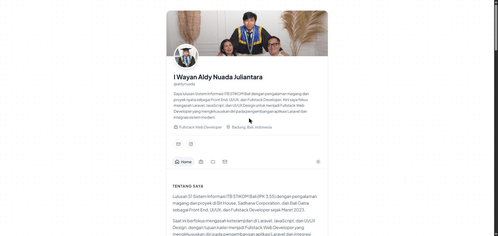
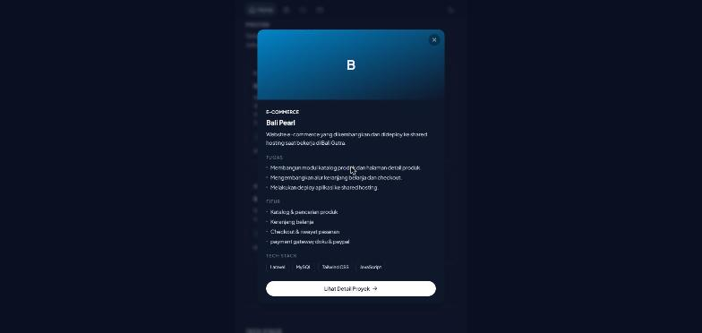

<div align="center">


# Portofolio — Aldy Nuada

**I Wayan Aldy Nuada Juliantara** · Fullstack Web Developer · Badung, Bali 🌴

Website portofolio pribadi yang dibangun dengan **HTML, CSS, dan JavaScript murni** —
tanpa framework, tanpa build step, cukup buka dan jalan.


[✉️ Email](mailto:aldynuada132@gmail.com) · [📸 Instagram](https://instagram.com/aldy_nuada)

</div>

---

## 📸 Tampilan

<table>
  <tr>
    <td align="center"><b>Mode Terang</b></td>
    <td align="center"><b>Mode Gelap — Detail Proyek</b></td>
  </tr>
  <tr>
    <td></td>
    <td></td>
  </tr>
</table>

## ✨ Fitur

| | Fitur | Keterangan |
|---|---|---|
| ⚡ | **Navigasi tanpa refresh** | Pindah halaman hanya mengganti isi konten — banner, profil, dan navbar tetap di tempat. Tombol Back/Forward browser tetap berfungsi. |
| 🌌 | **Background luar angkasa** | Bintang berkelip, nebula yang bergerak pelan, bintang jatuh, dan planet bercincin — warnanya menyesuaikan mode terang/gelap. |
| 🌗 | **Mode gelap & terang** | Mengikuti pengaturan sistem, bisa diganti lewat tombol di navbar, dan pilihan tersimpan di browser. |
| 🗂️ | **Detail proyek** | Klik kartu proyek untuk membuka modal, atau buka halaman detail lengkap dengan galeri gambar. |
| 📝 | **Konten di satu file** | Semua teks ada di `assets/js/data.js` — ubah isi website tanpa menyentuh HTML. |
| 📱 | **Responsif** | Nyaman dibaca dari HP sampai desktop. |
| 🔊 | **Suara navigasi** | Bunyi "tick" halus saat menu diklik. |
| 📂 | **Bisa dibuka dari file** | Jalan dengan klik dua kali `index.html`, tanpa server. |

## 📁 Struktur Folder

```
portopolio/
├── index.html            # Home: profil, tentang, pengalaman, proyek, tech stack, kontak
├── experience.html       # Pengalaman kerja
├── projects.html         # Daftar semua proyek
├── project.html          # Detail proyek  →  project.html?slug=bali-pearl
├── favicon.ico
├── assets/
│   ├── css/style.css     # Semua styling + mode gelap
│   ├── js/data.js        # 📝 SEMUA KONTEN WEBSITE ADA DI SINI
│   ├── js/main.js        # Render komponen, navigasi, modal, galeri, tema
│   ├── images/           # Foto profil & banner
│   └── sounds/           # Suara klik navigasi
└── docs/screenshots/     # Gambar untuk README
```

## 🚀 Menjalankan

**Cara paling cepat** — klik dua kali `index.html`. Selesai.

**Lewat server lokal** (alamat jadi lebih rapi, misalnya `/experience.html`):

```bash
python -m http.server 5500
```

Lalu buka **http://localhost:5500**.

> [!TIP]
> Setelah mengubah file, tekan **Ctrl + F5** supaya browser tidak memakai versi lama yang tersimpan di cache.

## ✏️ Mengubah Konten

Semua konten ada di **`assets/js/data.js`**. Edit, simpan, lalu refresh browser.

<details>
<summary><b>👤 Profil & kontak</b></summary>

```js
profile: {
    name: 'I Wayan Aldy Nuada Juliantara',
    title: 'Fullstack Web Developer',
    email: 'aldynuada132@gmail.com',
    whatsapp: null,          // contoh: '6281234567890' — null = tombol WhatsApp disembunyikan
    instagram: 'aldy_nuada',
    avatar: 'assets/images/profile.jpg',
    banner: 'assets/images/banner.jpg',
},
```

</details>

<details>
<summary><b>💼 Menambah pengalaman kerja</b></summary>

Tambahkan objek baru di array `experience` (urutan di array = urutan tampil):

```js
{
    role: 'Fullstack Developer',
    company: 'Nama Perusahaan',
    period: 'Jan 2026 — Sekarang',
    points: [
        'Apa yang dikerjakan.',
        'Pencapaian lainnya.',
    ],
},
```

</details>

<details>
<summary><b>🗂️ Menambah proyek</b></summary>

Tambahkan objek baru di array `projects`. `slug` dipakai di URL, jadi harus unik dan tanpa spasi:

```js
{
    name: 'Nama Proyek',
    slug: 'nama-proyek',
    category: 'Web App',
    description: 'Deskripsi singkat proyek.',
    tags: ['Laravel', 'Freelance'],
    images: [],
    tasks: ['Tugas yang dikerjakan.'],
    features: ['Fitur utama.'],
    stack: ['Laravel', 'MySQL'],
},
```

Halaman utama menampilkan 4 proyek pertama; sisanya muncul lewat tombol **Tampilkan Lebih Banyak**.

</details>

<details>
<summary><b>🖼️ Menambah gambar proyek</b></summary>

1. Simpan gambar di `assets/images/projects/`
2. Isi `images` pada proyek tersebut:

```js
images: [
    'assets/images/projects/bali-pearl-1.jpg',   // gambar pertama = cover
    'assets/images/projects/bali-pearl-2.jpg',
],
```

Proyek tanpa gambar otomatis tampil dengan kotak gradasi berisi huruf awal namanya. Kalau gambarnya lebih dari satu, galeri dengan tombol panah dan thumbnail muncul otomatis.

</details>

<details>
<summary><b>🧰 Tech stack</b></summary>

```js
techStack: [
    { name: 'Languages & Frameworks', skills: ['Laravel', 'JavaScript', 'PHP', 'jQuery'] },
    { name: 'Styling', skills: ['Tailwind CSS', 'Bootstrap'] },
    { name: 'Design & Tools', skills: ['Figma', 'Git'] },
],
```

</details>

## 🌐 Deploy

Karena hanya file statis, website ini bisa di-online-kan **gratis** tanpa konfigurasi:

| Layanan | Cara |
|---|---|
| **GitHub Pages** | Push ke GitHub → *Settings* → *Pages* → pilih branch `main` |
| **Netlify** | Drag & drop folder ini ke [app.netlify.com/drop](https://app.netlify.com/drop) |
| **Vercel** | Import repository → klik *Deploy* |

## ⚙️ Cara Kerja Navigasi

Setiap halaman berbagi bagian yang sama (banner, profil, navbar, kontak, footer). Saat menu diklik, `main.js` hanya mengganti isi `<div data-page-content>` lalu memperbarui alamat di browser — jadi tidak ada refresh.

| Dibuka lewat | Contoh alamat |
|---|---|
| Server / hosting | `/experience.html`, `/project.html?slug=creb` |
| File langsung (`file://`) | `index.html#!/experience.html` |

Mode alamat dipilih otomatis, karena browser tidak mengizinkan perubahan alamat ke file lain saat dibuka langsung dari folder.

## 📜 Riwayat

Website ini dikonversi dari versi **Laravel + Tailwind CSS + Livewire** sebelumnya. Kontennya dipindahkan dari database `db_portofolio` ke `data.js`, sehingga tidak lagi membutuhkan PHP, database, maupun panel admin.

---

<div align="center">

Dibuat dengan ☕ oleh **Aldy Nuada** · © 2026

</div>
